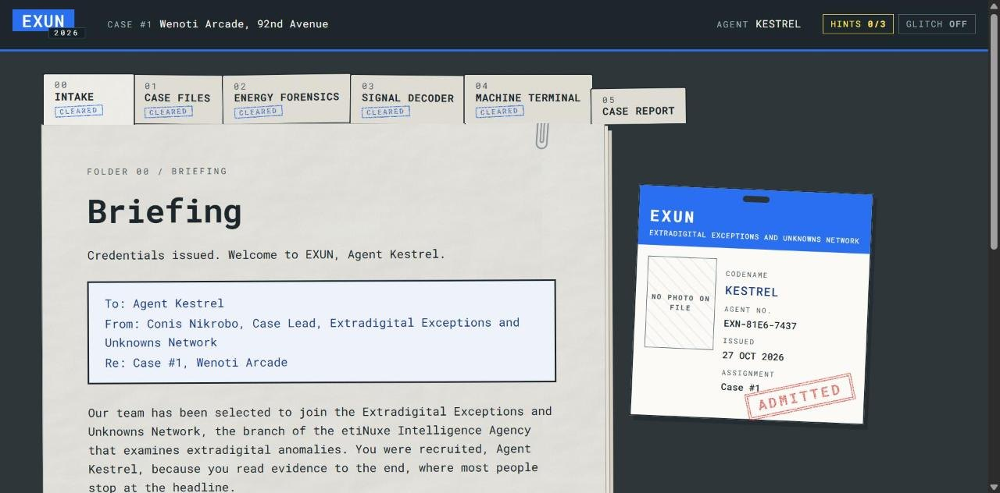
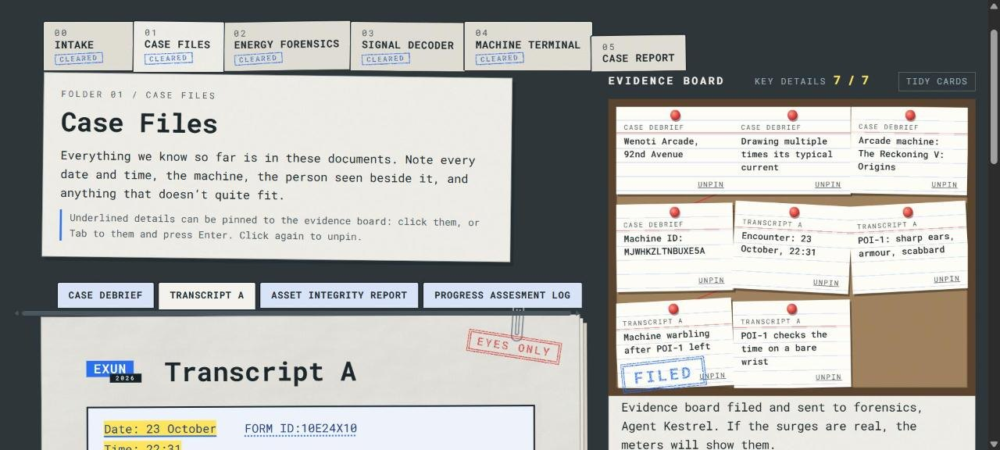
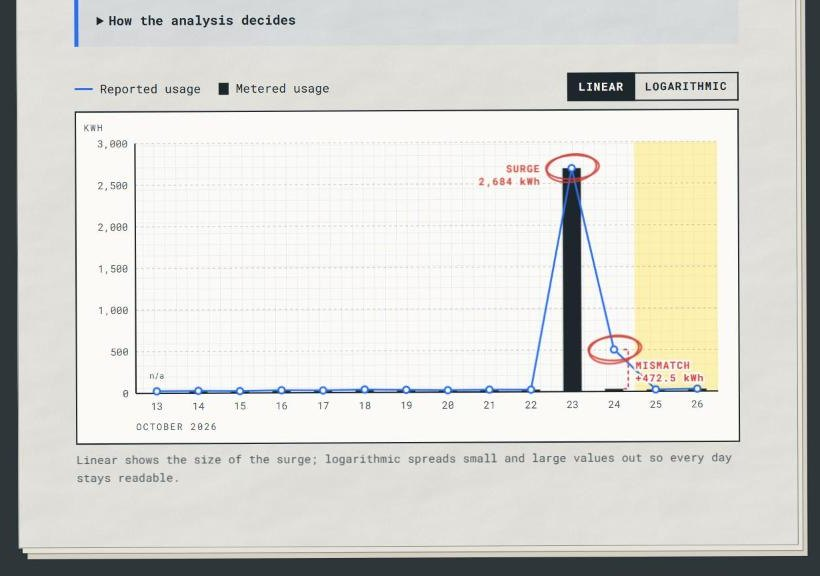
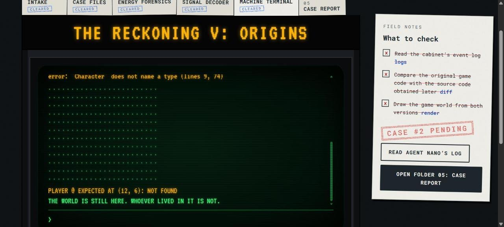
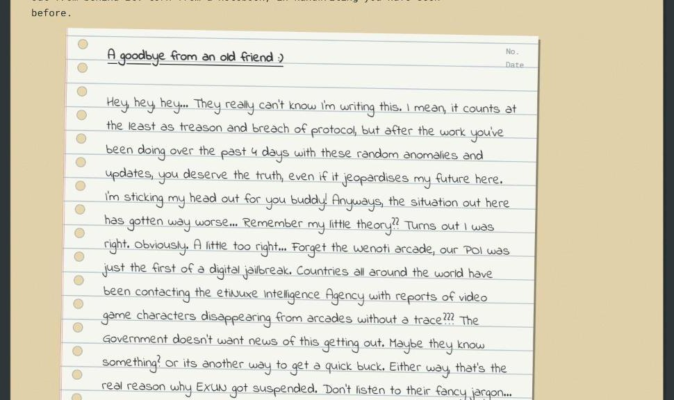

# EXUN Case Terminal: Case #1, Wenoti Arcade

An Exun 2026-27 Hackathon entry by **Team AFBBS** (Medhansh Sharma, Aryaveer Dalal, Mudit Shakya). The site is the case terminal of the Extradigital Exceptions and Unknowns Network (EXUN). You are a newly recruited agent working Case #1: the Wenoti Arcade on 92nd Avenue has been drawing many times its usual current, and the trail leads to the arcade machine *The Reckoning V: Origins*.

- **Live site:** https://wattsonbuild.vercel.app/
- **Judges:** https://wattsonbuild.vercel.app/?supervisor=1 opens every folder (see [Supervisor mode](#supervisor-mode)).
- **Ideation:** [docs/Ideation.pdf](docs/Ideation.pdf)

## The concept

The case is a folder of six stages. Each one unlocks the next, and each uses the real case material:

| Folder | What the agent does | What opens the next folder |
|---|---|---|
| 00 Intake | Picks a codename, gets an ID card, reads the briefing | Accepting the assignment |
| 01 Case Files | Reads the Case Debrief, Transcript A and the Asset Integrity Report; pins details to a corkboard. A fourth document, Agent Nano's log, stays sealed until the case is cracked | Pinning all 7 key details, then filing |
| 02 Energy Forensics | Runs an analysis of the Department of Electricity's meter data; reads the chart | A correct Discrepancy Referral (surge and mismatch) |
| 03 Signal Decoder | Decodes the Machine ID with six tools or auto-detect | Entering the decoded key |
| 04 Machine Terminal | Uses the cabinet's own screen: `logs`, `diff`, `render` | All three checks, which trigger the reveal |
| 05 Case Report | Reads a report written from what they did | Printing it or downloading it files it, and the ending arrives (below) |

The twist: POI-1, the "cosplayer" in Transcript A, is a character who crossed out of *The Reckoning V: Origins*, and the 23 October energy spike was the crossing. The machine terminal lets the agent find this for themselves:
- Comparing `OriginalCode.txt` with the game source code obtained on 24 October (`AlteredCode.txt`) shows the whole `Character` class has been removed.
- The game world drawn from the code has no player in it.

Once the agent gets there, Agent Nano's **Progress Assesment Log** (canon, written 23:54 on 25 October) arrives in the case files. It reaches the same conclusion ("He WASN'T a cosplayer!!!"), and a red-pen note from Nano appears on Transcript A. The log ends on the question canon leaves open, *why* the character escaped, which is the hook for Case #2. The story text itself is the team's own and lives in `content/story.json`.

Filing the report isn't quite the end. Two more canon documents arrive, and they turn the ending around:

1. **The Suspension Notice** (canon, effective 27 October) lands in an in tray above the report. The Government of Nuxeland suspends EXUN, calling the findings "inconclusive". The notice tells all personnel to acknowledge receipt, so the agent has to.
2. Acknowledging it puts a suspension bar on every page and files the notice in the case files.
3. **Agent Nano's goodbye note** then slides out from behind it, in handwriting. It isn't filed anywhere because it's off the record. It says the agent's case was "just the first of a digital jailbreak": characters are vanishing from arcades worldwide, the Government doesn't want the news getting out, and that, says Nano, is the real reason EXUN was suspended.
4. The note ends "What are you going to do now?", and the agent answers: comply with the suspension, or keep investigating off the record. The choice is final, and it shows in the report and on the suspension bar.

As the case goes on, the arcade machine's glitches bleed into the agency's paper pages, and redactions in the case files lift as the agent's clearance grows.

## Screenshots

**00 Intake.** The briefing, and the agent's ID card stamped Admitted.



**01 Case Files.** The official documents on the left; the seven key details pinned to the corkboard on the right.



**02 Energy Forensics.** The meter data, worked out day by day: the 23 October surge and the 24 October mismatch ringed in red.



**04 Machine Terminal.** RENDER draws the game world from the code: the player belongs at (12, 6), and isn't there.



**The ending.** After the Suspension Notice, Agent Nano's goodbye note slides out from behind it.



## Features, by judging criterion

**Creativity**
- An in-world desk instead of a website: paper sheets with grain and creases, overlapping folder tabs, worn red stamps, a paperclip, a corkboard with index cards and red string, a pink carbon-copy referral form, ticker tape, a manila access card, an arcade cabinet with a green CRT and a deck of arcade buttons, and for the ending, a manila in tray and a page torn from a notebook.
- The glitch "bleed": three levels, one per stage cleared from Energy Forensics on. Stamps misprint, headings tear, tabs flicker, then scanlines and a rolling green bar spread over the agency pages.

**Originality**
- The puzzles are built on the provided material, not invented: real meter arithmetic, the real Machine ID, the real C++ files.
- The terminal's `diff` is a real line-by-line comparison of the two code files. Its `render` draws the 24 x 12 world using the size, start position and symbols read from the code itself.

**Progression of storyline**
- Sealed folders open in order.
- Redactions in Transcript A and the Asset Integrity Report lift when later folders are cleared, and a lifted detail becomes new pinnable evidence.
- Agent Nano's log is visible from the start as a sealed tab, and opens only after the reveal, so the canon confirmation never spoils the agent's own discovery. The report then gains a timeline built from the case files.
- The glitch bleed grows with progress.
- The reveal plays only after the agent has run all three checks, and ends on the hook for Case #2.
- After the report is filed, the Suspension Notice arrives. It isn't listed in the case files before then, so its tab can't give the ending away. Acknowledging it suspends EXUN on every page, and Agent Nano's note leads to the agent's final choice.
- The case report is written from the agent's own run: what they pinned, what they filed, how long it took, how many hints they used.

**Functionality**
- **Anomaly detection** (`src/lib/anomalies.js`): works out each day's metered usage from the meter readings. It flags surges with a median-based "modified z-score" and mismatches where the reported and metered figures differ. Nothing is hard-coded: the tests run it on made-up data with anomalies on other dates. On the dossier it finds the Oct 23 surge (2,684 kWh) and the Oct 24 mismatch (reported 503.2, metered 30.7).
- **Hand-built SVG chart**: linear and logarithmic scales, flagged days ringed, with a text description for screen readers.
- **Decoders** (`src/lib/decoders.js`): Base64 (including URL-safe), Base32, hex, ASCII codes (decimal or binary), Caesar (all 25 shifts) and reverse, each able to encode and decode, plus auto-detect ranked by a readability score. Decoding `MJWHKZLTNBUXE5A` (Base32) gives `blueshirt`, which opens the machine.
- **Evidence board**: drag cards with mouse, touch or pen, or move them with the arrow keys. New cards land in a grid sized to the board, and "Tidy cards" lays them all out again with none overlapping.
- **Progress** is saved in the browser (localStorage). If the browser blocks it, the site still works for that visit. A small **Reset** button in the top bar erases it, after asking to be sure.
- **Case report**: print or save as PDF, or download as `.txt`.
- **Hints**: three per stage, opened one at a time.
- **Supervisor mode**: for judges (see below).
- **231 automated tests** (see [Tests](#tests)).

## Supervisor mode

Add `?supervisor=1` to the address, before the `#`:

```
https://wattsonbuild.vercel.app/?supervisor=1#/forensics
```

- Every folder is open, and stages can be cleared in any order.
- Progress is saved separately (`exun-case-1-supervisor`), so it never touches an agent's own save.
- A red bar under the top bar offers:
  - **Mark every folder cleared:** shows the full glitch bleed and the closed report.
  - **Reset this session:** wipes the supervisor save only.
  - **Leave supervisor mode:** returns to the same page in normal mode.
- A report made in supervisor mode is stamped "Supervisor override".
- After marking everything cleared, run `logs`, `diff` and `render` in the Machine Terminal to see the reveal. The Suspension Notice and the rest of the ending wait at the top of the Case Report.

## Run it locally

You need [Node.js](https://nodejs.org) 22 or newer (built and tested with Node 24).

```bash
npm install
```

```bash
npm run dev
```

Then open http://localhost:5173 (or http://localhost:5173/?supervisor=1).

Other commands:

| Command | What it does |
|---|---|
| `npm test` | Runs all the tests once |
| `npm run build` | Builds the site into `dist/` |
| `npm run preview` | Serves the built `dist/` to check it |
| `npm run todo` | Lists every TODO-TEAM slot still to fill, with file and line |

## Deploying

The live site is hosted on **Vercel** at https://wattsonbuild.vercel.app/, built from this repository: Vercel runs `npm run build` and serves `dist/`.

Every push also runs the tests and the build on GitHub Actions (`.github/workflows/ci.yml`), so a broken change shows up as a red cross on the commit. That workflow doesn't publish anything.

Asset paths are relative (`base: './'` in `vite.config.js`) and routing uses `#` addresses, so the built `dist/` folder works on any static host, under any folder name, without server settings.

## Accessibility

- **Keyboard:** everything works without a mouse. Divider tabs and decoder methods use the arrow keys. Evidence cards move with the arrow keys (Shift for bigger steps), and Delete unpins one. Escape closes the hints window. A "Skip to the open folder" link appears on the first Tab press.
- **Screen readers:** every control has a name; pinning, filing, decoding and unlocking are announced; the chart has a text description, with the same data in the table above it; each screen sets the page title.
- **Small screens:** works at 360px wide with no sideways page scrolling. Wide tables, the chart and the code scroll inside their own boxes.
- **Reduced motion:** if the device asks for reduced motion, glitches switch off (the Glitch button is greyed out), the typing effect is skipped, and other animations finish instantly. Anyone can also turn glitches off with the **Glitch** button in the top bar.
- **Contrast:** all visible text was checked against WCAG AA (at least 4.5:1, or 3:1 for large text).
- **Sound** is off until the agent turns it on.

## Tests

```bash
npm test
```

231 tests in 12 files, covering:

- **Anomaly detection:** real data, made-up data, edge cases.
- **Every decoder and auto-detect:** official RFC 4648 examples, padding, bad characters and lengths, URL-safe Base64, non-text bytes, emoji, empty input.
- **The unlock rules:** order, tampered saves, blocked storage, supervisor mode.
- **The referral form and the access key.**
- **The code diff and game-world reader.**
- **The case report:** finished, unfinished, blank, supervisor and suspended runs, plus a check that it never prints "undefined", "null" or "NaN".
- **The ending:** the notice only after filing, no choice before acknowledging, a final choice, and saves edited to skip ahead.
- **Hints and codenames.**
- **The integrity of `content/canon.json`:** every pin is clickable, no key detail is redacted or sealed, Nano's log is sealed until the reveal, the red-pen note quotes the log word for word, and the Suspension Notice and Nano's note stay hidden until the report is filed and keep the PDFs' wording.

## Project structure

```
index.html              the page shell
src/
  main.js               starts the site: fonts, styles, saved progress, router, top-bar buttons
  router.js             which screen to draw for the address (#/files etc.)
  state/                progress, unlock rules, saving (progress.js, store.js, stages.js)
  lib/                  logic with no page code (all tested): anomalies, decoders, diff,
                        arcade code reader, evidence board, referral, machine key, report,
                        the ending (epilogue), hints, codename, chart scales
  ui/                   one file per screen (intake, casefiles, forensics, signal, terminal,
                        report) plus the ending (epilogue) and shared pieces (shell,
                        document, evidenceBoard, energyChart, hints, artSlot, audio,
                        effects, dom)
  styles/               base, agency (paper), bleed (glitch spread), one file per screen, print
content/
  canon.json            the official documents, word for word
  story.json            the team's story text
  assets.json           slots for the team's artwork and audio
  hints.json            three hints per stage
data/energy.json        the dossier's table, copied and checked against the PDF
tests/                  Vitest tests
scripts/list-todos.js   lists the remaining TODO-TEAM slots
src/assets/             put artwork (art/) and audio (audio/) files here
public/favicon.svg      the browser-tab icon
public/og-image.jpg     the picture chat apps show when the link is shared
case-files/             the official case PDFs and the two arcade code files
docs/Ideation.pdf       the Ideation deliverable
docs/screenshots/       the screenshots in this README
```

The official PDFs (including `progress-assessment-log.pdf`, `SuspensionNotice.pdf` and `NoteFromNano.pdf`) and the two code files (`OriginalCode.txt`, `AlteredCode.txt`) are in `case-files/`. They are canon: the site quotes them and never contradicts them.

## Content: what is canon and what is ours

- **Canon:** `content/canon.json` holds the text of the Case Debrief, Transcript A, the Asset Integrity Report, the Energy Usage Dossier, Agent Nano's Progress Assesment Log, the Suspension Notice and Agent Nano's goodbye note, copied word for word (typos included). It also holds a short timeline of dated events from those documents, and Nano's red-pen note, which quotes his log. `data/energy.json` is the dossier's table; every row was checked against the PDF. The terminal reads the code files directly.
- **The team's own:** the narrative in `content/story.json`, plus the artwork and audio listed in `content/assets.json`.
  - Put a picture in `src/assets/art/` (or a sound in `src/assets/audio/`) with the file name listed for its slot, and it appears on the site by itself. The site finds the files when it's built, so it never requests a file that isn't there.
  - Until then, `npm run dev` shows a labelled frame naming the file to add, and the live site shows a plain stand-in.
  - The Sound button only appears once at least one sound file exists.
  - Unwritten story slots show on the page with a dashed red outline.
- **Hints** (`content/hints.json`) point only at the case material. Any figures in them (dates, kWh, the decoded key) are filled in from the data, so they stay correct.

## Built with

Vite, vanilla JavaScript, plain CSS and Vitest. There's no framework, UI kit or icon library, and no backend: it is a static site. The fonts are Roboto Mono (agency pages, matching the PDFs), VT323 (the CRT screen) and Indie Flower (Agent Nano's handwriting), bundled through `@fontsource`.

## Team AFBBS

Made for the Exun 2026-27 Hackathon by:

- Medhansh Sharma
- Aryaveer Dalal
- Mudit Shakya

The names also appear on every page and at the end of the case report; they come from `content/team.json`.
